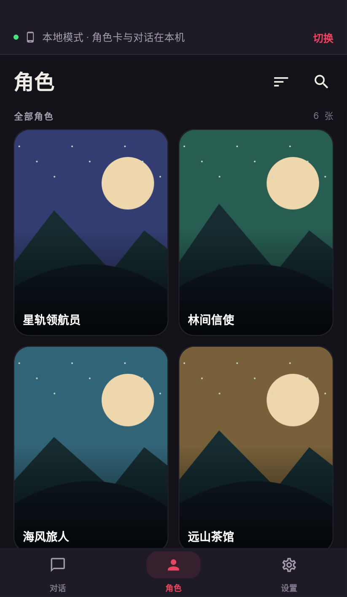
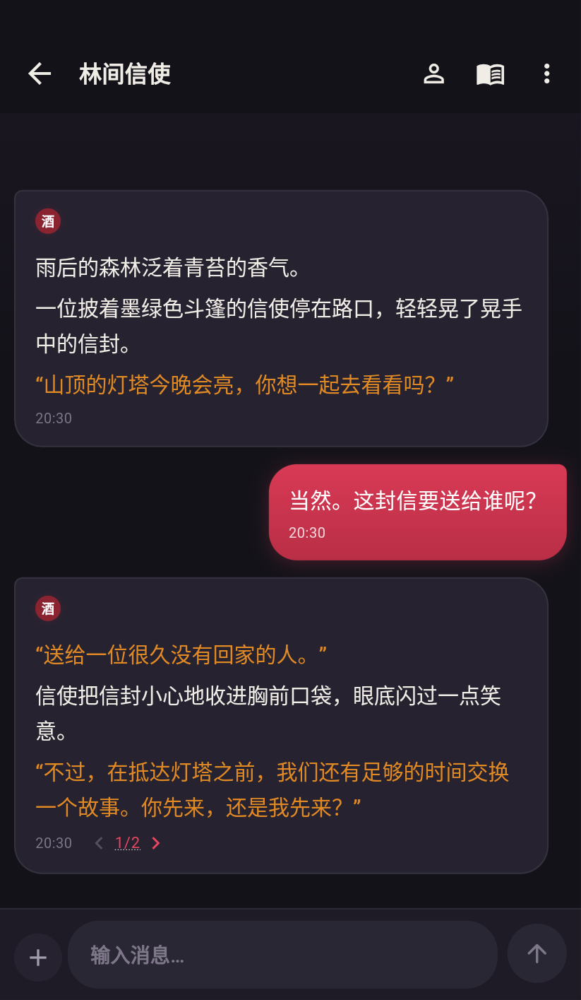
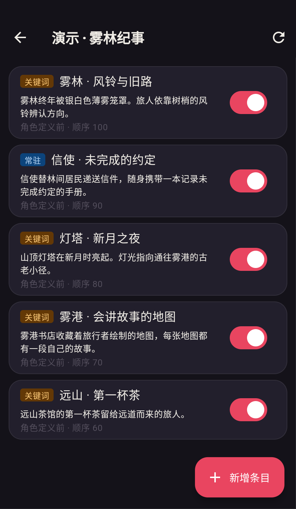
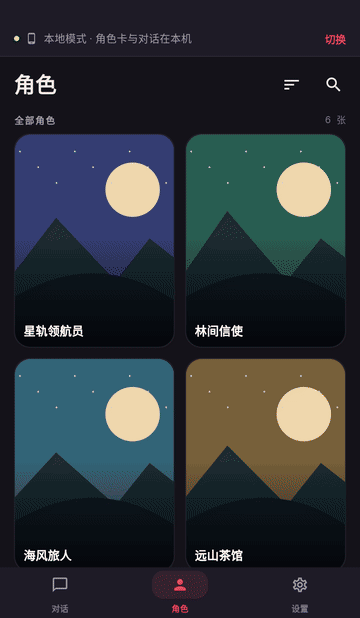

<h1 align="center">PocketTavern · 掌上酒馆</h1>

An Android AI roleplay chat app with on-device data, direct model connections, and SillyTavern server access.

  <a href="https://github.com/wacilimonster-source/pockettavern/releases/latest"><strong>Download APK</strong></a> ·
  <a href="docs/quick-start.en.md">Quick start</a> ·
  <a href="https://github.com/wacilimonster-source/pockettavern/issues">Report an issue</a> ·
  <a href="README.md">简体中文</a>

## Screenshots

<table>
  <tr><th width="33%">Characters</th><th width="33%">Conversations</th><th width="33%">World info</th></tr>
  <tr>
    <td></td>
    <td></td>
    <td></td>
  </tr>
</table>

Captured from the v1.15.5 app using original demonstration characters, illustrations, and dialogue. The app interface shown is in Chinese.

Watch a 15-second walkthrough

Browse characters, switch a response variant, send a message, and watch a streaming reply. Captured from the real interface with a preset demonstration response.

## Features

- **Organize characters and settings.** Browse, search, sort, and pin characters, then configure world info and personas.
- **Shape your conversations.** Edit messages, regenerate responses, continue a reply, and switch between response variants.
- **Read and chat on your phone.** Use a touch-oriented portrait interface with streaming replies and collapsible reasoning content.
- **Manage long conversations.** Configure author's notes, summaries, vector memory, and context budgets.
- **Use your existing SillyTavern library.** Connect to your server or sync selected data to your phone.

## Two ways to use PocketTavern

| | Local mode | Remote mode |
| --- | --- | --- |
| Characters, chats, and world info | Stored on the phone | Stored on your SillyTavern server |
| Generation requests | Sent directly to the configured model service | Forwarded through SillyTavern |
| Initial setup | Sync selected server data and configure a model service | Connect to an accessible SillyTavern server |
| Typical use | Manage a local copy of your library and conversations | Continue using your server library and chat history |

Local mode uses on-device data. Generating replies uses the model service you configure, including its network access, credentials, and usage limits.

## Get started

1. Open the [latest release](https://github.com/wacilimonster-source/pockettavern/releases/latest).
2. Under **Assets**, download and install `pocket_tavern_VERSION.apk` on Android.
3. Choose a mode.
   - **Remote** — enter your SillyTavern address, connect, and choose a character.
   - **Local** — choose **先在本机开一间** on the welcome screen, then use **设置 → 远程数据源** to sync selected data from your SillyTavern server. Configure the model under **设置 → AI 服务**.
4. Open an existing conversation or create a new one.

See the [English quick-start guide](docs/quick-start.en.md) for detailed steps and the Chinese labels used in the app. Existing users can install updates over their current installation or check for updates under **设置 → 通用 → 检查更新**.

## Compatibility

- The source selector offers DeepSeek, GEMINI网关, OpenCode Go, and 自定义. The custom source supports configuring OpenAI-compatible endpoints.
- Character cards, world info, chat files, and presets follow relevant SillyTavern data formats. The sync preview lists the available data categories.
- Core prompt assembly, world info, regex, and macro behavior are compared against SillyTavern **1.19.0**.
- Message scripts, variable bridges, and a subset of EJS templates are adapted. Support for a complex card depends on the extension features it uses. Reproducible examples help investigate compatibility issues.

## FAQ

**Does SillyTavern need to stay running?**

Remote mode requires access to your SillyTavern server. After local data has been synced and a direct model connection configured, local-mode conversations use the phone's data and the configured model service.

**Where are my chats stored?**

Remote-mode chats live on your SillyTavern server. Local-mode chats live in the app's private directory on the phone. Each mode uses its own data. You can review server differences and sync selected updates through the remote data source screen.

**Why is my local character list empty?**

Use **设置 → 远程数据源** to sync characters from your SillyTavern server. See the [local-mode guide](docs/quick-start.en.md#local-mode).

**How do I report a problem?**

Open an [issue](https://github.com/wacilimonster-source/pockettavern/issues/new) with the app version, Android version, mode, reproduction steps, and expected behavior. Remove API keys, tokens, and private conversations before sharing screenshots or sample files.

## About this project

This repository distributes APK releases, release notes, and user documentation. The application source code is currently private.

PocketTavern is a third-party Android client for [SillyTavern](https://github.com/SillyTavern/SillyTavern). Thanks to SillyTavern and its community. Conversation content depends on the model service, character cards, and prompts configured by the user.

If PocketTavern helps you, consider starring the project or sharing it with someone who enjoys AI roleplay on Android.

[Project sharing image](assets/social-preview.png)
