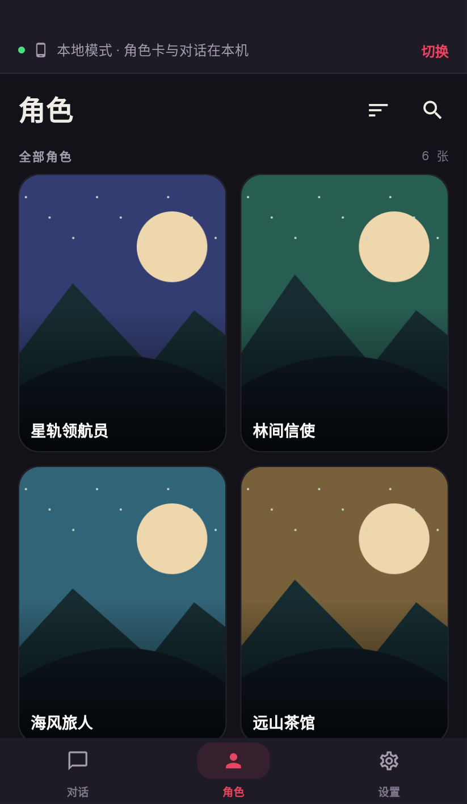
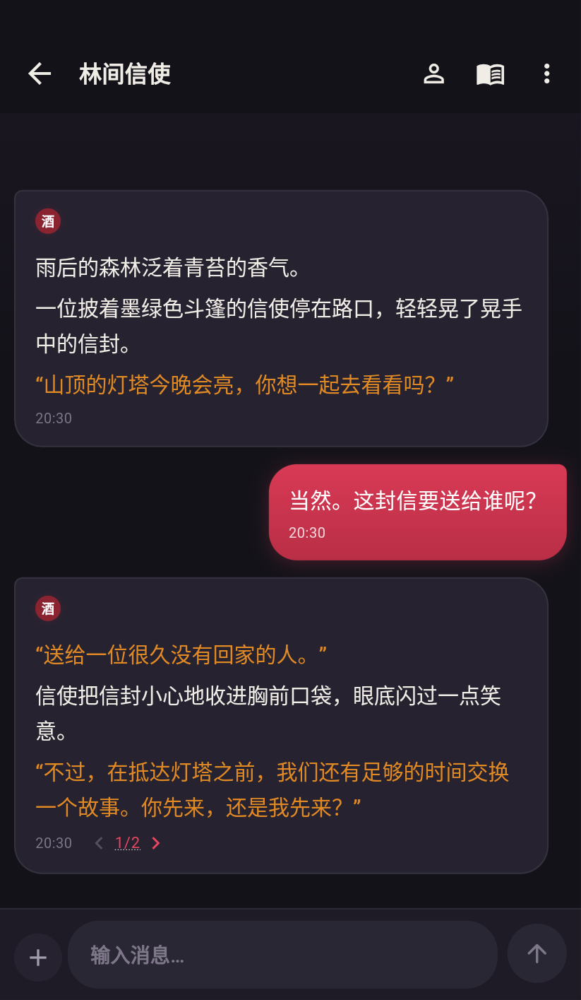
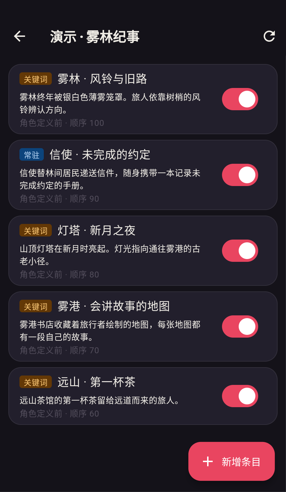
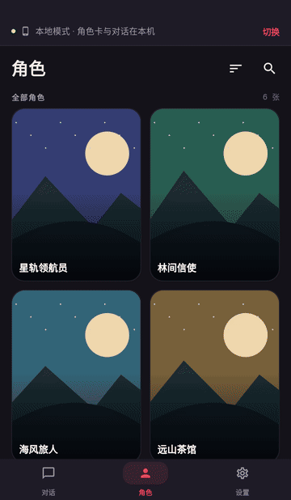

<h1 align="center">掌上酒馆 PocketTavern</h1>

Android AI 角色聊天应用，支持本机数据与模型直连，也可连接 SillyTavern 服务端。

  
  
  

  <a href="https://github.com/wacilimonster-source/pockettavern/releases/latest"><strong>下载最新版 APK</strong></a> ·
  <a href="docs/quick-start.md">快速上手</a> ·
  <a href="https://github.com/wacilimonster-source/pockettavern/issues">问题反馈</a> ·
  <a href="README.en.md">English</a>

## 界面预览

<table>
  <tr><th width="33%">管理角色</th><th width="33%">参与对话</th><th width="33%">编写世界设定</th></tr>
  <tr>
    <td></td>
    <td></td>
    <td></td>
  </tr>
</table>

截图采自 v1.15.5 的真实应用界面，角色、插图与对话为专门制作的演示内容。

查看 15 秒操作演示

浏览角色、切换回复变体、输入并发送消息、查看流式回复。动画采自真实界面，使用预设的演示回复。

## 你可以用它做什么

- **管理角色与设定**。浏览、搜索、排序和置顶角色，为对话配置世界书与人设。
- **调整故事走向**。编辑消息、重新生成回复、继续生成，或切换不同回复变体。
- **在手机上阅读和交流**。使用适配竖屏与触控的界面，查看流式回复与可折叠的思考内容。
- **管理长对话的上下文**。配置作者注释、前情摘要、向量记忆和上下文预算。
- **沿用已有的酒馆资料**。连接自己的 SillyTavern 服务端，或把所需资料同步到本机后使用。

## 选择适合你的使用方式

| | 本地模式 | 远程模式 |
| --- | --- | --- |
| 角色卡、对话与世界书 | 使用本机资料 | 使用 SillyTavern 服务端资料 |
| 模型请求 | 手机直连配置的模型服务 | 经 SillyTavern 服务端转发 |
| 首次准备 | 从远程数据源同步资料，配置模型服务 | 准备手机可访问的 SillyTavern 地址 |
| 使用场景 | 将已有资料带到手机，管理本机对话 | 继续使用自己部署的酒馆与服务端聊天记录 |

本地模式指数据在本机，生成回复仍通过所配置的模型服务完成。模型服务的可达性、Key 与用量由所使用的提供商决定。

## 快速上手

### 安装

1. 打开 [最新版发布页](https://github.com/wacilimonster-source/pockettavern/releases/latest)。
2. 在 **Assets** 中下载 `pocket_tavern_版本号.apk` 并安装。
3. 已安装的用户可以覆盖安装更新，也可在「设置 → 通用 → 检查更新」中检查版本。

### 连接已有的 SillyTavern

1. 在欢迎页填写服务端地址，例如 `http://192.168.1.100:8000`。
2. 连接成功后进入「角色」，选择角色，再打开已有对话或新建对话。
3. 在「设置 → AI 服务」核对生成源、模型与配置，开始聊天。

### 使用本机数据聊天

1. 在欢迎页选择「先在本机开一间」，或在设置中切换为本地模式。
2. 打开「设置 → 远程数据源」，添加自己的 SillyTavern 地址，选择要同步到本机的角色、对话和配置。
3. 在「设置 → AI 服务」配置生成源、地址、Key 和模型。网关源使用相应的网关设置。
4. 返回「角色」，打开角色并创建对话。

详细步骤见 [快速上手指南](docs/quick-start.md)。

## 兼容性与生成配置

- 当前提供 DeepSeek、GEMINI网关、OpenCode Go、自定义四种生成源入口，自定义入口用于配置 OpenAI 兼容端点。
- 角色卡、世界书、聊天文件和预设等数据沿用 SillyTavern 的相关格式，可同步内容以 App 中的数据源预览为准。
- 提示词组装、世界书扫描、正则与宏等核心行为以 SillyTavern **1.19.0** 为对照基线。
- 消息内脚本、变量桥接和 EJS 模板子集已有适配，复杂角色卡的表现取决于所用扩展功能。遇到兼容问题时，可以提供最小示例以便核查。

## 常见问题

### 需要一直运行 SillyTavern 吗？

远程模式需要手机能够访问 SillyTavern 服务端。本地模式完成资料同步并配置直连模型后，聊天使用本机资料与所配置的模型服务。

### 聊天记录保存在哪里？

远程模式保存在 SillyTavern 服务端。本地模式保存在手机的应用私有目录。两种模式使用各自的数据，切换模式时保留已有资料；需要从服务端获取更新时，可进入远程数据源查看差异并选择同步。

### 刚进入本地模式，角色列表为空怎么办？

打开「设置 → 远程数据源」，从自己的 SillyTavern 服务端选择角色资料同步到本机。详见 [本地模式指南](docs/quick-start.md#本地模式)。

### 服务器连接不上怎么办？

先确认手机浏览器能够打开同一服务端地址。局域网连接需要手机和服务器处于可互相访问的网络中；公网连接需要配置可访问的服务地址。账号登录、访问控制与网络设置请按自己的 SillyTavern 部署方式检查。

### 下载或检查更新失败怎么办？

可直接到 [Releases](https://github.com/wacilimonster-source/pockettavern/releases) 手动下载。在网络恢复后重试 App 内更新检查。

### 如何反馈问题？

请在 [Issues](https://github.com/wacilimonster-source/pockettavern/issues/new) 中提供 App 版本、Android 版本、运行模式、操作步骤与预期结果。截图和最小角色卡示例有助于复现，提交前请移除 Key、访问令牌和个人聊天信息。

## 项目说明与致谢

本仓库用于发布 APK、更新说明和使用文档，应用源码目前未公开。

掌上酒馆是 SillyTavern 的第三方 Android 客户端。感谢 [SillyTavern](https://github.com/SillyTavern/SillyTavern) 及相关社区项目。对话内容由用户配置的模型服务、角色卡与提示词共同生成。

如果掌上酒馆对你有帮助，欢迎 Star，或将项目分享给需要手机端角色聊天的朋友。

[项目分享图](assets/social-preview.png)
